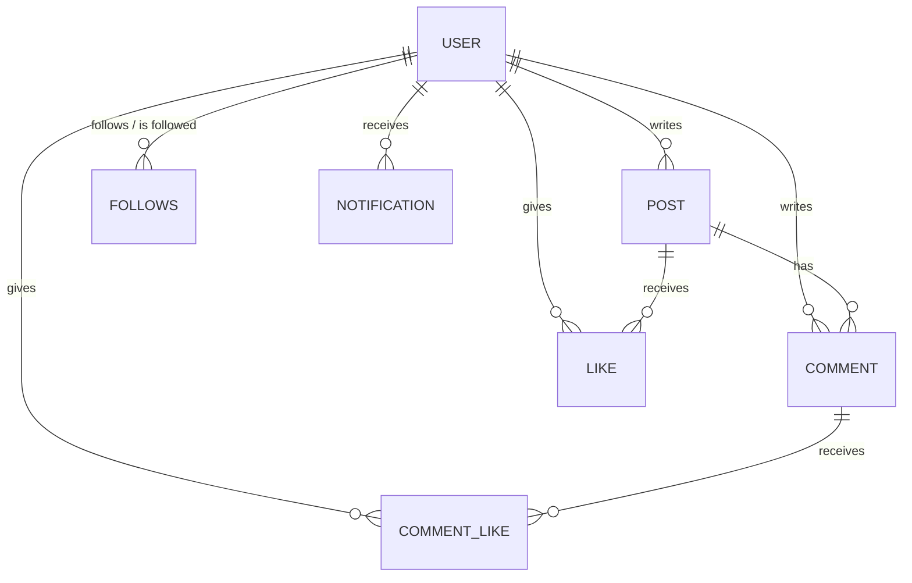

<h1 align="center">Social media backend</h1>

<p align="center">
  A REST API for a short-post social network: profiles, follows, posts with images,
  comments, likes and notifications, with email and Google authentication.
</p>

<p align="center">
  
  
  
  
  
  
</p>

## Features

- **Accounts:** sign-up and sign-in with email and password (Passport local strategy), JWT access and refresh tokens, sign-out, forgotten password with a code sent by email, password change, and sign-in or sign-up with Google.
- **Profiles:** picture, bio (160 characters) and location; update or delete your profile.
- **Follows:** follow and unfollow, check whether you follow someone, list followers and following, and follower counts.
- **Posts:** text up to 280 characters with an optional image (uploaded to Cloudinary); page-based pagination, or a cursor for infinite scroll; like and unlike; delete your own posts.
- **Comments:** comment on a post, list a post's comments, like a comment, delete your own.
- **Notifications:** created when someone likes your post, comments on it, likes your comment or follows you; list them, mark them as read, delete them.
- **Uploads:** one image or up to 5 at once, sent to Cloudinary.

## Data model



A like is unique per user and post (and per user and comment); notification types are `LIKE`, `COMMENT`, `COMMENT_LIKE` and `FOLLOW`.

## API

| Area          | Routes                                                                                                                       |
| ------------- | ---------------------------------------------------------------------------------------------------------------------------- |
| Auth          | `POST /auth/signup`, `/auth/signin`, `/auth/signout`, `/auth/refreshToken/:refresh_token`, `/auth/reset-password`, `/auth/verify-code`, `/auth/change-password`, `/auth/change-password-for-logged-in-user` |
| Google        | `GET /oauth/google/sign`, `/oauth/google_/callback`                                                                          |
| Users         | `GET /users/profile`; `PATCH /users/update_profile`; `DELETE /users/delete_profile`; `POST /users/toggle-follow/:targetUserId`; `GET /users/is-following/:targetUserId`, `/users/followers/:userId`, `/users/following/:userId`, `/users/follow-counts/:userId` |
| Posts         | `GET /posts/all` (`page`, `limit` or `cursor`), `GET /posts/:id`, `POST /posts/create` (multipart, field `image`), `POST /posts/:id/toggle-like`, `DELETE /posts/delete/:id` |
| Comments      | `GET` and `POST /comment/post/:postId`, `DELETE /comment/:commentId`, `POST /comment/:commentId/toggleLike`                   |
| Notifications | `GET /notification`, `POST /notification/mark-read`, `DELETE /notification`                                                 |
| Uploads       | `POST /cloudinary/upload` (field `file`), `POST /cloudinary/upload-multiple` (field `file[]`, up to 5)                       |

## Tech stack

| Area           | Tools                                                                 |
| -------------- | --------------------------------------------------------------------- |
| API            | NestJS, TypeScript, `class-validator`                                 |
| Database       | PostgreSQL, Prisma (migrations in `prisma/migrations`)                |
| Authentication | Passport (local, JWT, Google OAuth 2.0), bcrypt, express-session      |
| Files          | Multer, Cloudinary                                                    |
| Email          | `@nestjs-modules/mailer`, Nodemailer                                  |
| Infrastructure | Docker, Docker Compose                                                |

## Getting started

### With Docker Compose

```bash
git clone https://github.com/ay-boutera/social-media-backend.git
cd social-media-backend
# create .env (see below), then:
docker compose up --build
```

This starts PostgreSQL (on host port 5433), applies the Prisma migrations, and runs the API on http://localhost:3000 with hot reload. Note that the `migrate` service runs `prisma migrate reset --force`, so **the database is emptied at every start**: it is meant for development.

### Without Docker

```bash
npm install
npx prisma migrate dev
npm run start:dev
```

### Configuration

| Variable                                                                 | Purpose                               |
| ------------------------------------------------------------------------ | ------------------------------------- |
| `DATABASE_URL`                                                           | PostgreSQL connection string          |
| `PORT`                                                                   | HTTP port (3000)                      |
| `JWT_SECRET`, `JWT_EXPIRATION_TIME`, `JWT_REFRESH_SECRET`, `JWT_REFRESH_EXPIRATION_TIME` | Access and refresh tokens |
| `SESSION_SECRET`                                                         | Session cookie (Google sign-in)       |
| `GOOGLE_CLIENT_ID`, `GOOGLE_CLIENT_SECRET`, `GOOGLE_CALLBACK_URL`        | Google OAuth 2.0                      |
| `EMAIL_USERNAME`, `EMAIL_PASSWORD`, `MAIL_USER`                          | Emails with password-reset codes      |
| `CLOUDINARY_NAME`, `CLOUDINARY_API_KEY`, `CLOUDINARY_API_SECRET`         | Image storage                         |

## Project structure

```
src/
├── auth/            # sign-up, sign-in, tokens, password reset (local and JWT strategies)
├── oauth/           # Google sign-in
├── user/            # profiles and follows
├── post/            # posts, pagination, likes
├── comment/         # comments and comment likes
├── notification/    # notifications
├── cloudinary/      # image uploads
├── prisma/          # Prisma client service
└── common/          # JWT helpers, decorators, session middleware
prisma/              # schema and migrations
```

## Author

[Boutera Ahmed Yassine](https://github.com/ay-boutera)
